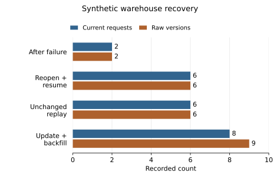

# NYC 311 Service Monitor

A local SQLite pipeline and Streamlit dashboard for NYC 311 requests. It retains
source versions, resumes interrupted page loads, and keeps request demand,
latest observed open status, and time to recorded closure separate.

[Workflow and code map](WORKFLOW.md) · [Metric definitions](docs/METRICS.md) ·
[Verification record](docs/VERIFICATION.md)

## Recovery example—not a city service result



This plot reads the [committed offline demonstration](outputs/synthetic_warehouse_demo.json).
Six hand-authored synthetic requests exercise failure, database reopen, resume,
and unchanged replay. Updating one request and adding two yields eight current
requests and nine retained versions. It demonstrates fixture behavior, **not NYC
service performance, throughput, or citywide backlog**.

[Plot source, hashes and reproduction](docs/VISUAL_EVIDENCE.md). The plot uses the
actual committed-byte hash. Existing legacy provenance hashes match CRLF
re-encodings rather than the committed LF files; those historical files are
preserved, not silently corrected.

## Run the offline demo

Use Python 3.11 or 3.12 in a virtual environment. From the repository root:

```sh
python -m venv .venv
# Activate .venv for your shell, then:
python -m pip install -r requirements.txt
python -m unittest discover -s tests -v
python scripts/demo_warehouse.py --output demo-report.json
streamlit run app.py
```

The demo uses temporary synthetic SQLite data; it makes no API calls. The default
dashboard opens the historical aggregates already in the repository—it does not
show the synthetic recovery fixture as city data. See the
[verification record](docs/VERIFICATION.md) for the historical Windows/PyArrow
troubleshooting note.

## Load a real creation-date window

This optional command contacts NYC Open Data. The end date is exclusive;
`SOCRATA_APP_TOKEN` is optional and read from the environment.

```sh
python scripts/fetch_and_build.py --start 2024-01-01 --end 2024-01-03 --output data/refreshed
```

Set `NYC311_DATA_DIR=data/refreshed` in your shell before running Streamlit to view
that output. For example, use `export NYC311_DATA_DIR=data/refreshed` in a POSIX
shell or `$env:NYC311_DATA_DIR = "data/refreshed"` in PowerShell.

The loader pages all statuses, upserts by request ID, and commits each page with
its restart cursor. Repeat a window for a backfill; add `--refresh-open` to revisit
older loaded creation days containing open requests. After a failure, use
`--resume-run RUN_ID` with that run's exact start/end/page-size. Completed run IDs
are no-ops; omit the flag to observe later source changes.

## Evidence and limits

- **The default dashboard is a legacy biased sample.** Detailed records were
  limited to the earliest 350 closed records/day and cleaned to remove invalid,
  negative, and over-45-day durations. Daily counts also required a closed date.
  Its 30,626 cleaned records and 91 days are not new-pipeline results.
- The old 48-hour percentage is not an all-request SLA rate; recorded closure is
  not first response or verified resolution. Legacy MAPE and retrospective
  anomaly flags do not validate the new training-only calibration.
- The retained [live smoke check](outputs/live_api_smoke.json) covers only four
  records across two pages. No complete new live window or independent source
  count reconciliation is documented.
- Open counts are latest observed statuses in loaded creation cohorts, not
  historical point-in-time or citywide backlog. The client has no source snapshot
  isolation or deletion capture. Late inserts and changes to closed requests
  require explicit backfills; wall-clock durations do not correct for DST.
- This is a single-operator local project, not a scheduled or managed deployment.
  Fixture tests do not establish scale, concurrency, or alert quality.

[CI passed for the inspected base revision](https://github.com/Zinga18018/nyc-311-service-monitor/actions/runs/34859039455).
That historical run is not a claim about later changes. The plot's standard-library
checks run with the unit suite; optional exact rendering needs
`requirements-visuals.txt`.

Source: [NYC Open Data API documentation](https://dev.socrata.com/foundry/data.cityofnewyork.us/erm2-nwe9).
